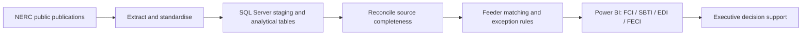
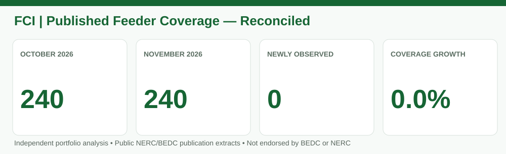
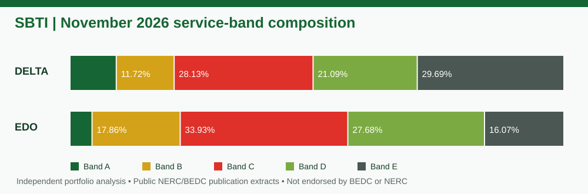
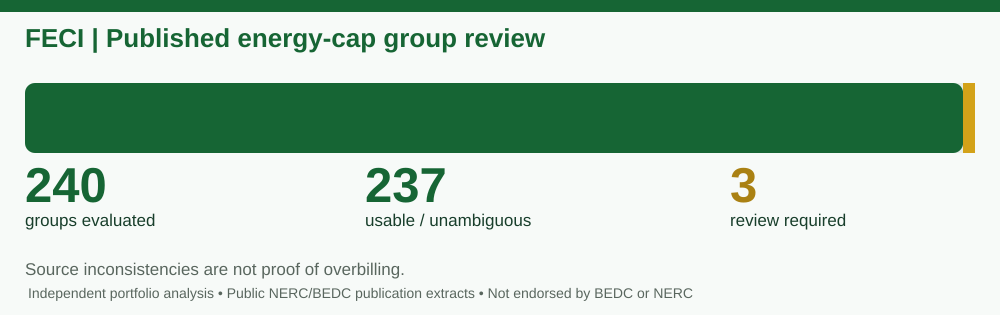
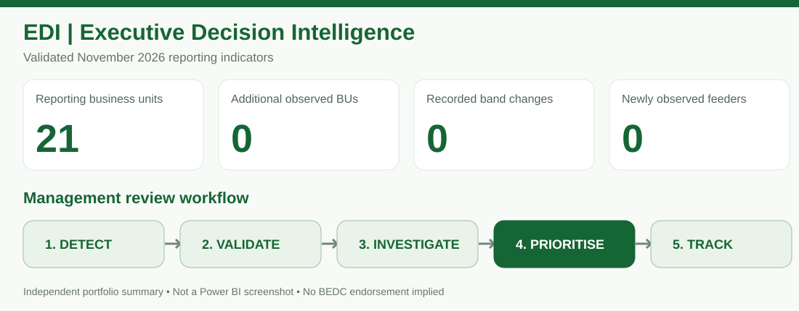
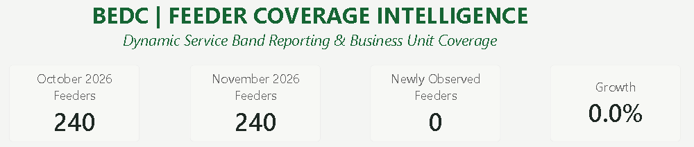
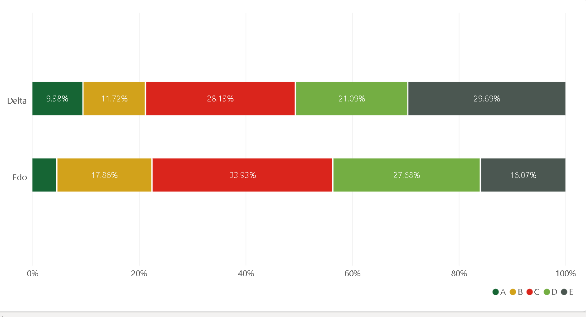
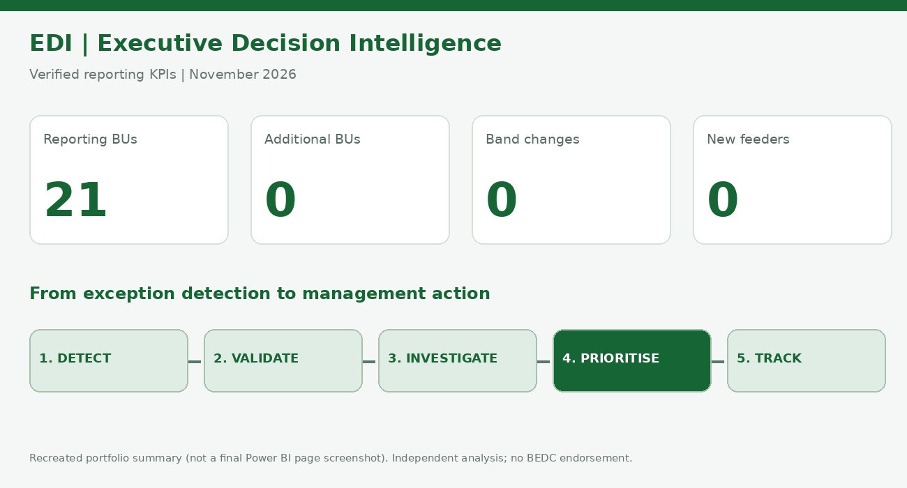
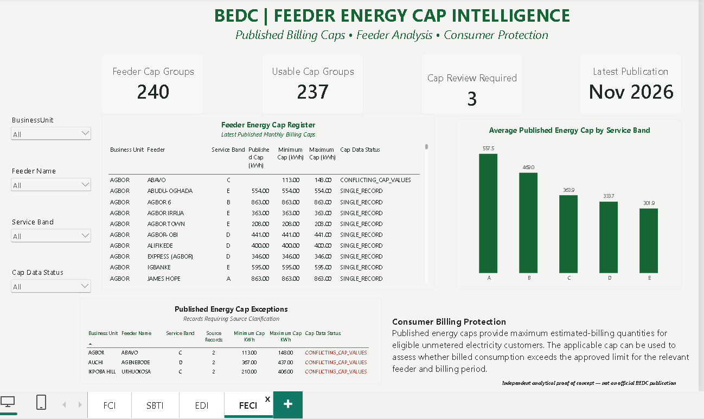

# DESI–BEDC | Distribution Executive & Service Intelligence

**Independent electricity-distribution analytics proof of concept — Benin Electricity Distribution Plc (BEDC)**

**SQL Server · Power BI · DAX · Data Quality · Feeder Coverage · Service Bands · Estimated-Billing Energy Caps**

> **Independence statement:** This is an independent portfolio project. It was **not commissioned, endorsed, verified, or operated by BEDC or the Nigerian Electricity Regulatory Commission (NERC)**. Its findings come from independently processed public regulatory publications, not BEDC internal operations data.

## Executive overview

Distribution Executive & Service Intelligence (**DESI**) demonstrates how public regulatory information can support traceable, management-oriented analytics for electricity distribution. This **BEDC edition** evaluates feeder identities, published service-band classifications, and estimated-billing energy caps reported in NERC's **October and November 2026** BEDC publications.

The reconciled analytical extract covers **Delta and Edo States**, **21 reporting business units**, and **240 distinct published feeder identities in each month**. This count refers to the publication extract; it is **not** a census of BEDC's physical feeder network.

## Intelligence modules

| Module | Management question | Demonstrated capability |
|---|---|---|
| **FCI** — Feeder Coverage Intelligence | Is apparent reporting growth real, or a data-coverage problem? | Reconciled feeder and business-unit coverage |
| **SBTI** — Service Band Transition Intelligence | Which published classifications changed? | Feeder matching, band comparisons, and state-level band mix |
| **EDI** — Executive Decision Intelligence | Which reporting exceptions require a management response? | KPI summary and Detect → Validate → Investigate → Prioritise → Track workflow |
| **FECI** — Feeder Energy Cap Intelligence | Which published energy-cap records need clarification? | Cap-register analysis and conflicting-value flags |

## Validated findings

| Indicator | Result |
|---|---:|
| Published feeder identities — October 2026 | **240** |
| Published feeder identities — November 2026 | **240** |
| Reporting business units in the reconciled extract | **21** |
| Newly observed feeder identities between publications | **0** |
| Recorded service-band changes in matched identities | **0** |
| November feeder-band cap groups evaluated | **240** |
| November cap groups with usable/unambiguous values | **237** |
| November cap groups requiring source clarification | **3** |

### Data-assurance case study: correcting a misleading trend

An initial October ingestion omitted **114 source records**, creating an apparent **87.5%** increase in published feeder coverage between October and November. Reconciliation with the original publication identified the incomplete import, recovered the omitted records, corrected affected mappings, and restored the October comparison population to **240 distinct feeder identities**.

The corrected feeder-coverage growth was **0.0%**.

**Management lesson:** An attractive reporting dashboard can still lead to the wrong decision when ingestion completeness and source lineage are not checked.

[Read the full data-quality case study](docs/DATA_QUALITY_CASE_STUDY.md).

## Validated November 2026 band composition

| State | A | B | C | D | E | Total distinct feeder identities |
|---|---:|---:|---:|---:|---:|---:|
| Delta | 12 | 15 | 36 | 27 | 38 | **128** |
| Edo | 5 | 20 | 38 | 31 | 18 | **112** |
| **Total** | **17** | **35** | **74** | **58** | **56** | **240** |

The percentage composition is calculated within each state. These are **published classification counts**, not independently measured electricity supply hours.

## Analytical workflow

**Technology:** Microsoft SQL Server / T-SQL for ingestion and reconciliation, Power BI / DAX for four-page reporting, and manual source-validation checks.

## Validated portfolio visuals

The following are **recreated, static analytical summaries of verified results**, **not screenshots of the Power BI report**.

### Validated Power BI screenshots and portfolio excerpts

**FCI — Feeder Coverage Intelligence** (reconciled KPI excerpt; 240 feeders in each reporting period, 0 newly observed)

**SBTI — Service Band Transition Intelligence** (corrected Delta–Edo published service-band mix)

**EDI — Executive Decision Intelligence** (recreated management summary/workflow; **not a Power BI screenshot**)

**FECI — Feeder Energy Cap Intelligence** (validated dashboard capture; cap-group review)

These portfolio images use the **post-reconciliation** results. FCI and SBTI are excerpts, EDI is a recreated summary, and FECI is a dashboard capture. Older contradictory pre-reconciliation images have been excluded.

A public PBIX and database backup are **not** supplied at this stage; they require data, credential, connection, licence, and reproducibility checks before distribution.

## Interpretation boundaries

- A newly observed publication row is not necessarily a newly commissioned physical feeder.
- Service-band labels do not independently prove actual electricity availability.
- Published **estimated-billing energy caps (kWh)** are **not** measurements of feeder energy dispatched or customer consumption.
- Three inconsistent cap groups are **data-quality exceptions requiring clarification**, **not allegations of overbilling**.
- The November 2026 publication uses **October 2026 as its energy-consumption reference month**. The publication month and reference month should not be conflated.
- This portfolio does **not** claim commercial savings, operational integration, or a BEDC-sponsored pilot.

See [methodology and limitations](docs/METHODOLOGY_AND_LIMITATIONS.md).

## Source publications

- [NERC — BEDC monthly energy cap, October 2026](https://nerc.gov.ng/resources/benin-electricity-distribution-plc-monthly-energy-cap-october-2026/)
- [NERC — BEDC monthly energy cap, November 2026 (PDF)](https://nerc.gov.ng/wp-content/uploads/2026/11/Benin-Electricity-Distribution-Plc.-Monthly-Energy-Cap-November-2026.pdf)
- [NERC — 2026 document catalogue](https://nerc.gov.ng/resource-category/2026/)

Links point to the publisher's materials rather than duplicating its full PDFs and tables. Check the publisher's terms before reuse.

## Repository contents

- [Data reconciliation case study](docs/DATA_QUALITY_CASE_STUDY.md)
- [Methodology, scope, and interpretation limits](docs/METHODOLOGY_AND_LIMITATIONS.md)
- [Publication checklist](docs/PROJECT_SCOPE_AND_PUBLICATION_CHECKLIST.md)
- [Power BI screenshot gallery and release checklist](docs/POWER_BI_SCREENSHOT_GALLERY.md)
- [Power BI report availability](powerbi/README.md)
- [SQL publication status](sql/README.md)
- [Source data status](data/README.md)
- [LinkedIn portfolio copy](docs/LINKEDIN_FEATURED_COPY.md)

## Development direction

DESI is conceived as a potentially reusable **framework**. This repository is specifically **DESI–BEDC**. Any other DisCo implementation would have its own separately validated dataset, reports, provenance, and repository. No claim of adoption or endorsement by any DisCo is intended.

## Author

**Ndubuisi Anozie** — power-sector performance, business intelligence, and analytics.  
GitHub: [@nanozie-coder](https://github.com/nanozie-coder)
